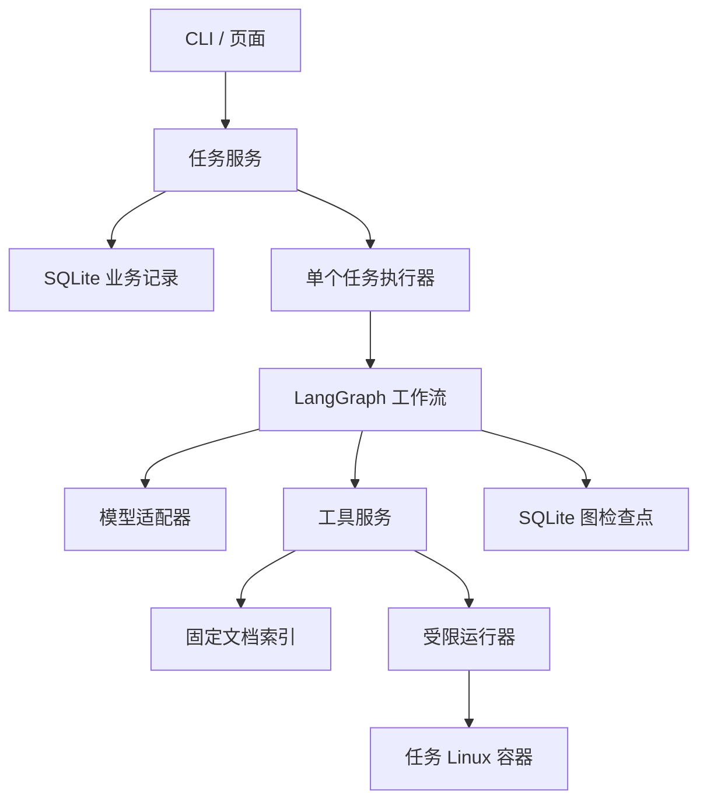

# EnvDesk Code Design Spec 1.0

| 项目 | 约定 |
| --- | --- |
| 文档版本 | 1.0 |
| 日期 | 2026-10-20 |
| 文档状态 | 实现规格基线；功能尚待实现与验收 |
| 首要设计原则 | AI native：以目标、上下文、工具和反馈闭环组织产品与代码 |
| 设计基线 | `5f42ac22d940d90e7441760ccb70f1a91b9ba617` |
| 目标交付 | 本地、单用户、限定案例的 Python 环境与依赖排障应用 |
| 主要技术 | Python、Pydantic、LangGraph、SQLite、FastAPI、Docker |

本文固定 1.0 的产品范围、代码边界、数据契约、状态语义和验收条件。文中的“必须”“不得”是实现要求；“建议”允许在记录理由后调整。规格完成不表示功能完成：基线提交只有初始化包，本文所列工具、接口、模块、案例和测试均需后续实现。

本文是 1.0 技术契约的主文档。[架构概览](architecture.md)、[开发路线](roadmap.md)和[评测规范](evaluation.md)用于导航与解释；如出现冲突，应先修订文档，不得由实现者静默选择不同语义。改变操作权限、成功判据、状态或接口契约必须更新规格版本与变更记录。

## 1. 产品目标与范围

### 1.1 目标

开发者提供一个登记案例、问题描述和原始报错。EnvDesk 获取真实环境事实，必要时检索版本适用的官方资料或追问，生成候选操作，经用户确认后执行，并独立判断原目标是否恢复。

1.0 要回答三个问题：根因判断是否有事实支持；修改是否符合确认内容；原业务入口是否恢复且原有约束保留。

### 1.2 AI native 首要原则

本项目首先以 AI native 的方式设计。产品的基本单位是一个具有目标、当前证据和完成条件的排障任务；模型根据实际观察决定下一步，程序为它提供可信上下文、可组合工具、持久状态和可验证的执行结果。先设计这套闭环，再确定页面与服务如何承接任务。

| 设计问题 | 1.0 必须采用的方式 |
| --- | --- |
| 谁决定诊断路径 | Agent 根据现有事实选择检查、检索、追问、提出计划或停止；允许补充证据后回到先前问题 |
| 谁解释工具结果 | 模型形成可核查的诊断与未决项；工具返回观察事实、来源和不确定性 |
| 如何行动 | 模型组合允许操作并提出预期影响；用户确认后，程序执行存储的计划 |
| 如何判断进展 | 新证据与实际执行/验证结果回到下一轮上下文；模型据此调整判断、重新取证、修订计划或结束 |
| 谁决定完成 | 目标与约束在任务开始时固定，由独立验证器判断是否恢复；模型负责解释证据与剩余问题 |
| 如何证明 Agent 的价值 | 用同症状不同根因、信息缺失和反馈变化案例，检查决策是否随证据变化，并与真实规则/单次模型基线比较 |

五类故障是首版能力与评测范围，不是五条按 `case_id` 或错误关键词写死的诊断流水线。规则可以核验事实、参数、权限和状态，不能替 B2 Agent 预填参考根因、指定唯一正确动作或固定每一轮工具顺序。规则方案作为 B0 独立对照保存。

用户主要提供目标、补充必要事实并确认具体修改。页面优先展示当前判断及证据、待确认动作、实际结果和下一步；提示词、工具名称和图节点不成为用户完成任务的前置知识。AI native 的验收依据是自主决策能否产生可核查的任务进展，不以对话轮数、模型数量或组件数量计分。

### 1.3 支持的五类问题

| 类别 | 需要取得的事实 | 1.0 允许处理的范围 |
| --- | --- | --- |
| Python 版本不满足约束 | `requires-python`、实际解释器版本、已登记环境 | 选择已存在且满足约束的任务环境 |
| 解释器或虚拟环境选错 | 原启动入口、实际运行环境、项目预期环境 | 显式调整任务的环境绑定 |
| 已声明依赖未同步 | 声明、锁文件、目标环境的已安装分发包 | 同步已有声明及已批准的安装集合 |
| 声明与锁文件不一致 | 元数据、固定 uv 版本的锁检查结果 | 在原约束内更新锁文件，再按计划同步 |
| 已声明 extra 未启用 | 任务需要的功能、extras 声明、安装集合 | 启用指定且已声明的 extra |

没有登记的兼容解释器、未声明的依赖、无法离线获得的依赖、真正不可满足的版本约束，应说明证据并返回未解决。不得通过猜测包名安装、放宽约束或自动下载解释器扩大范围。

### 1.4 交付范围

- 本地单用户应用；首版执行环境固定为一种 Linux 架构。
- 登记的可信最小案例、文本描述与日志；每个任务使用独立工作副本。
- 三个业务工具：`inspect_case`、`search_docs`、`verify_candidate`。
- 单个模型适配器、LangGraph 工作流、计划确认、固定验证器、SQLite 记录。
- CLI、FastAPI、简单页面、逐例运行记录和可复现说明。
- 首例闭环后扩展开发案例；最终 1.0 需有覆盖上述五类问题的实际证据。

以下能力留待后续规格：任意仓库自动修复、真实用户目录写入、Jupyter 内核管理、Windows/macOS 原生执行覆盖、CUDA/GPU、任意 shell、在线安装任意包、多租户、多人协作、微调、多智能体与分布式队列。Linux 容器中的结果不能宣称已经覆盖这些环境。

## 2. 用户流程与交付行为

| 场景 | 用户动作 | 系统必须展示的结果 |
| --- | --- | --- |
| 提交问题 | 选择案例，填写描述、原始命令说明与日志 | 任务 ID、当前阶段、已接收材料 |
| 信息不足 | 回答针对缺失信息的追问 | 新材料记录、继续诊断的状态 |
| 查看方案 | 查看诊断、证据和操作列表 | 操作影响、目标环境、可能的删除/替换范围、待确认状态 |
| 确认/拒绝 | 确认当前计划或拒绝 | 绑定具体计划的确认记录；拒绝时不修改 |
| 查看结果 | 读取结论及执行轨迹 | 实际变化、原业务检查结果、约束检查、未解决原因 |
| 等待后继续 | 在等待确认时重启应用 | 同一任务与计划可继续；确认有效性重新核对 |

页面用“等待补充信息”“等待确认”“正在验证”“需要核查”“已解决”“无需修改”“未解决”“已取消”等业务文案。操作编号、哈希和内部异常栈放在可展开的详情中。

同样的 `ModuleNotFoundError` 应能对应不同根因，例如环境选错、已声明依赖未同步、extra 未启用。案例展示不提前标注根因。正常环境以及应用代码错误属于独立行为案例，用于验证“无需修改”或“超出支持范围”的处理。

## 3. 系统结构与技术决策

### 3.1 组件关系



这些是单个应用内的模块。仅案例运行在隔离容器中，不拆分微服务。CLI 和 HTTP 接口复用同一任务服务，不各自实现确认或执行规则。

### 3.2 决策表

| 决策 | 1.0 选择 | 理由与边界 |
| --- | --- | --- |
| 语言 | 应用基线 Python 3.12 | 标准库解析 TOML，工具与服务使用同一语言；案例可包含其他已登记解释器 |
| 编排 | LangGraph 状态图 | 动态选择只读工具，明确追问、确认与恢复节点 |
| 数据校验 | Pydantic 严格模型 | 不接受未知操作、额外字段或隐式类型转换 |
| 模型 | `httpx` 实现一个 OpenAI-compatible Chat Completions 适配器 | 统一为 §5.3 的决策；实际模型由可信配置指定，协议见 §12 |
| 业务存储 | 标准库 `sqlite3`，独立 `state.sqlite3` | 单用户与单执行器足够；事务不跨模型调用或子进程 |
| 图检查点 | `langgraph-checkpoint-sqlite`，独立 `checkpoints.sqlite3` | 避免将图恢复与业务执行记录混成同一个保证 |
| 检索 | SQLite FTS5/BM25，固定官方文档快照 | 文档量小，片段与来源容易核查；embedding 为可选比较项 |
| HTTP | FastAPI + Uvicorn 单 worker | 受理任务、状态查询、确认和轨迹读取 |
| 页面 | 同源 HTML/CSS/原生 JavaScript | 仅实现任务列表与任务详情；轮询足以完成首版 |
| 案例执行 | 固定 Linux Docker 镜像，每任务一个容器 | 将案例环境与 EnvDesk 运行环境分开 |

应用依赖的精确版本在 S0 首次实现时解析、实测并写入 `uv.lock`。案例环境另存 `toolchain.json`：操作系统/架构、镜像 digest、Python 实际版本、uv 实际版本、依赖与离线资源哈希。模型使用的 provider/model 标识、返回的模型版本信息和配置也逐次记录。本文不把未安装验证过的版本写成已验证兼容矩阵。

S0 退出前必须具备这些固定版本记录；运行与评测阶段禁止使用浮动 `latest` 镜像或临时改变依赖版本。FTS5 与检查点组件兼容性也在 S0 验证。

### 3.3 模块与依赖方向

以下路径是待创建的实现结构。

| 路径 | 职责 | 不应承担的职责 |
| --- | --- | --- |
| `src/envdesk/config.py` | 本地配置、预算与模型连接配置 | 从案例日志加载配置 |
| `src/envdesk/domain.py` | 枚举、严格输入输出模型、不可变记录 | 调用数据库或子进程 |
| `src/envdesk/cases.py` | 可信案例登记、材料白名单、案例版本 | 向模型暴露参考答案 |
| `src/envdesk/workspaces.py` | 创建任务副本、环境登记、状态指纹 | 自动修复故障 |
| `src/envdesk/runner.py` | 参数数组、执行时限、容器与进程控制 | 接受模型提供的 shell 或任意路径 |
| `src/envdesk/tools/inspect.py` | 实际环境的只读事实 | 安装依赖、导入未知项目代码 |
| `src/envdesk/tools/search.py` | 文档切分、版本筛选、检索 | 在线任意网页访问 |
| `src/envdesk/tools/verify.py` | 协调已确认操作与固定验证 | 自行确认、改变已存储计划 |
| `src/envdesk/plans.py` | 计划校验、规范化、内容哈希 | 绕过证据校验执行操作 |
| `src/envdesk/storage.py` | 业务事务、幂等、事件序号、迁移 | 持有长事务等待模型 |
| `src/envdesk/model.py` | 一个模型协议与一个实际适配器 | 直接执行工具副作用 |
| `src/envdesk/workflow.py` | 图状态、模型决策、条件路由 | 将模型文本当成功标签 |
| `src/envdesk/service.py` | 任务、补充输入、确认、调度、恢复 | 复制工具实现 |
| `src/envdesk/api.py`、`cli.py` | HTTP 与命令行适配 | 各自维护不同业务状态 |
| `src/envdesk/static/` | 页面与静态资源 | 在浏览器保存模型密钥 |
| `examples/cases/` | 可复现案例的输入与公开说明 | 混放运行时可读的答案 |
| `eval/`、`tests/` | 控制面验证器、参考材料、行为与集成测试 | 挂载进模型可读的案例工作区 |

依赖方向：入口 → service/workflow → 工具与业务服务 → storage/runner；`domain.py` 不依赖其他业务模块。参考答案只由案例制作和评测控制面读取。

## 4. 案例、副本与执行上下文

### 4.1 案例记录

可信 `CaseManifest` 至少包含 `case_id`、`case_version`、`template_hash`、镜像 digest、初始环境构建 recipe 标识、材料白名单、登记环境、原业务入口、允许变更集合、验证器标识和预算 profile。

`group_id`、故障类别、参考根因、参考修复与评分细节保存在评测记录中，不进入模型输入。`case_id` 使用中性编号。模型可见的操作集合由真实支持能力与权限决定，不按参考答案裁剪成唯一正确操作。

### 4.2 创建时即固定工作副本

1. 受理任务时分配 `task_id`、`workspace_id`；执行器在准备阶段建立与这些 ID 绑定的独享容器与工作目录，完成前不调用诊断模型。
2. 使用可信 recipe 在任务最终路径重建环境，不复制可迁移性未知的现成 `.venv`。
3. 记录初始文件与环境指纹、原入口输出、实际工具版本。
4. 之后的检查、计划、确认、操作和验证都绑定这一个副本。
5. 每次新评测运行重新创建副本。一个任务中的失败重规划继续使用该任务当前副本，并重新采集证据。

案例准备失败属于 `unresolved / setup_failed`，单列为基础环境/准备失败，不归因于模型根因判断。正式主指标的 N 是事前冻结的案例清单，冻结后的准备失败仍属于端到端未完成，保留在 N 中。排除不可复现案例只能在冻结前进行；条件于准备成功的完成率若另外报告，必须标明其不同分母。

### 4.3 TaskContext 与 RuntimeBinding

`TaskContext` 由程序注入，模型不能指定：

| 字段 | 类型 | 约束 |
| --- | --- | --- |
| `task_id`、`workspace_id` | UUID 字符串 | 当前任务与唯一副本 |
| `case_id`、`case_version` | 字符串 | 已登记案例，必须与工具参数一致 |
| `material_revision` | 非负整数 | 当前环境材料代次 |
| `material_hash` | SHA-256 十六进制 | 本节定义的状态指纹 |
| `runtime_id` | 枚举字符串 | 当前实际业务环境，来自任务登记表 |
| `active_extras` | 排序去重字符串列表 | 当前明确选择的 extras，不凭已安装包猜测 |
| `budget_remaining` | 结构化计数 | 模型不能增加预算 |

`RuntimeBinding` 登记环境 ID、容器内环境目录、解释器路径、基础解释器真实路径、版本和当前用途。虚拟环境的解释器符号链接可以指向登记的基础解释器；不能将正常链接一概当作路径逃逸，也不能允许任意链接目标。

原业务入口保存为可信 argv 模板、工作目录和白名单环境变量。日志中的原始命令是数据，不能直接执行。`select_environment` 只改变该入口的环境绑定，业务脚本、参数和验收目标保持不变。

### 4.4 状态指纹

`material_hash` 对规范化清单计算 SHA-256，清单包括：输入修订号、受管项目文件路径与内容哈希、锁文件、原入口配置、当前环境 ID、已选择 extras、各受管环境的解释器身份/版本/`pyvenv.cfg`、安装分发包清单及安装记录摘要。另保存不可修改应用文件、模板和验证器的指纹。

读取临时缓存、输出日志、时间戳和图检查点不改变材料代次；安装、锁更新、环境切换和输入变更会推进材料代次，使旧证据不能用于新计划。计划外漂移使尚未执行的旧确认失效。每次计划保存、确认和开始执行前重新核对。

一次确认授权完整有序计划：开始执行后的计划内预期变化不撤销本次已消费确认。每步记录前后指纹，并更新运行时环境/extra 上下文供下一步使用；计划外漂移或越界变化立即停止。执行后的新计划必须重新采集证据并确认。环境指纹用于发现受支持场景下的漂移，不宣称能识别任意恶意篡改。

## 5. 数据契约

### 5.1 基本规则

- UUID、UTC ISO-8601 时间、SHA-256 字符串统一格式；UI 可转换为本地时间。
- 严格校验，拒绝未知字段、非法枚举、超长列表和任意命令文本。
- 不可变对象保存后不原地修改；变更产生新对象或新修订。
- 路径以工作区内逻辑标识表达；模型不能选择宿主机绝对路径。

### 5.2 核心对象

| 对象 | 必要字段 | 关键不变量 |
| --- | --- | --- |
| `Task` | ID、案例版本、副本、状态、状态版本、输入修订、预算、当前计划、终止原因 | 状态变更使用版本比较；一个任务只有一个当前副本 |
| `Evidence` | ID、任务/副本、工具调用 ID、材料代次、类型、来源、观察值、采集时间 | 计划只能引用本任务当前有效的环境证据 |
| `DocumentChunk` | ID、URL、标题层级、快照/内容哈希、采集日期、适用版本、正文 | URL 不能替代正文支持关系；未知适用性明确标注 |
| `PlanDraft` | 诊断、证据 ID、文档片段 ID、有序操作、预期影响、未决项 | 模型提出；没有执行权限 |
| `Plan` | ID、任务/副本、材料代次/哈希、完整操作、展开的目标环境/extras/group 集合/命令模板版本、计划哈希、创建/失效时间 | 程序校验并保存；正文不可变 |
| `Approval` | ID、任务、计划 ID/哈希、材料哈希、决定、时间、消费状态 | 只能由用户确认入口或已声明的评测批准器创建 |
| `Execution` | ID、任务/计划、状态、当前步骤、运行器身份、前后指纹、实际变化 | 状态为 reserved/running/completed/failed/unknown/aborted；一个计划至多一个记录 |
| `ValidationResult` | ID、执行/任务/副本、材料哈希、验证器版本、检查项、结论、输出 | 绑定实际被检状态；操作退出码不决定通过 |
| `Event` | 任务 ID、单调序号、类型、关联 ID、时间、有限负载 | 用于回看与轮询；不包含密钥或内部推理链 |

### 5.3 模型决策

模型每次只能产生一种结构化决策：

| `kind` | 内容 | 程序处理 |
| --- | --- | --- |
| `tool_call` | `inspect_case` 或 `search_docs` 及合法参数 | 扣减预算后调用，将结果回填 |
| `ask_user` | 问题与缺失字段，最多三个问题 | 存储后进入 `needs_input` |
| `propose_plan` | `PlanDraft` | 校验证据与操作，存储计划，进入 `awaiting_approval` |
| `finish_unresolved` | 原因、已有证据、未解决项 | 进入 `unresolved` |
| `finish_no_change` | 无需修改的判断与证据 | 程序运行只读验证；符合条件才进入 `diagnosed` |

模型不能输出有效 `approval_id`，不能直接设置 `resolved`，不能调用未暴露工具。结构化输出错误最多反馈一次，重试计入预算；再次失败返回 `model_output_invalid`。模型异常不会获得无限循环机会。

### 5.4 计划示例

以下为接口结构示例，不是已运行案例或评测结果。示例环境、证据和 UUID 必须由实际运行替换。

```json
{
  "kind": "propose_plan",
  "diagnosis": "原业务入口使用的环境与项目环境不同。",
  "evidence_ids": ["11111111-1111-4111-8111-111111111111"],
  "document_chunk_ids": [],
  "operations": [
    {"kind": "select_environment", "env_id": "env_a"}
  ],
  "expected_effect": "使用已登记的 env_a 重试同一个业务入口。",
  "unresolved_questions": []
}
```

## 6. 三个工具契约

三个业务工具由程序实现。诊断阶段向模型开放前两个；`verify_candidate` 由固定执行节点在确认成功后调用。确认与执行顺序不由模型文本决定。

### 6.1 公共结果

所有结果包含 `call_id`、任务/案例/副本 ID、`material_revision`、`status`、`data`、`evidence_ids`、`duration_ms`、`error`、`output_truncated`。`status` 为 `ok | partial | error | unsupported`。

`error` 包含稳定 `code`、可读 `message` 和 `retryable`。无法观察的事实用 `unknown` 并说明原因，不能填写猜测值。原始输出与模型可见摘要分别保存；超限截断必须有标记。

### 6.2 inspect_case

```python
def inspect_case(
    case_id: str,
    check_type: CheckType,
    env_id: str | None = None,
    *, context: TaskContext,
) -> ToolResult: ...
```

`env_id` 省略时使用当前环境；只允许登记 ID。`case_id` 与任务不一致时拒绝。不同检查的返回字段如下。

| `check_type` | 返回事实 | 实现方式与限制 |
| --- | --- | --- |
| `python_version` | 选定环境版本、项目约束、兼容判定 | 登记解释器执行固定探测；用 `packaging` 解析约束 |
| `interpreter` | 原入口、当前环境、已登记环境身份 | 只读登记表并实际核对路径/版本；不改变绑定 |
| `dependencies` | 声明、规范化分发包名、已安装版本/位置、缺失候选 | 解析 TOML 和安装元数据；包分发名与导入名不假定相同 |
| `lock_state` | `fresh / stale / missing / unknown`、实际检查输出 | 固定版本的锁检查适配器；失败不能统一解释为 stale |
| `extras` | 已声明 extras、明确选择集合、相关安装事实 | 功能与 extra 的关系需来自任务/配置证据；未知则追问 |

探测使用标准库文件读取或受信任解释器的固定脚本。不得导入任意项目模块来判断“是否安装”；代码导入属于固定业务验证阶段。固定探测关闭字节码写入。

模型自主选择 `check_type` 和契约允许的目标环境。工具可以计算版本是否满足约束、声明与安装清单的差异等可重复事实，但不从案例登记信息返回参考根因或指定修复动作。初始准备不默认跑完五类检查后预填诊断；已经由用户提供的真实证据应直接保留。

`lock_state` 的候选命令为 `uv lock --check --offline --no-python-downloads`，cwd 和缓存目录由程序设置。必须在锁定 uv 版本上验证：项目文件、锁文件和安装状态在正常、错误、超时情况下均保持不变。离线元数据不足或解释器缺失返回 `unknown` 和具体错误。不能满足只读要求的适配器不得启用。

**禁止将默认 `uv run`、默认 `uv tree`、`uv sync` 作为只读检查。**`--locked` 的锁文件约束不能推出环境也不变化，`--frozen` 不能证明锁文件新鲜。[R1][R2]

### 6.3 search_docs

```python
def search_docs(
    query: str,
    tool_version: str,
    *, context: TaskContext,
) -> ToolResult: ...
```

查询最长 512 字符，固定 `top_k=5`，每段最多 1,200 字符。程序核对 `tool_version` 与案例实际工具版本，无法核对时标记适用性未知；不能仅接受模型声称的版本。

首批收集支持现有案例的官方材料；约 10–20 篇是后续规模目标。索引按标题和段落切分，保存来源、锚点、内容哈希与版本适用性。FTS5 使用固定分词配置，模型可将中文问题转换为包含错误名、命令和配置字段的技术查询。零命中返回空列表，不调用模型编造片段。

每次运行固定同一文档快照。资料是事实输入，不是修改权限或确认流程的指令。若引用版本适用性未知，最终报告必须披露；正式引用正确率不将其计作已确认适用。

### 6.4 verify_candidate

```python
def verify_candidate(
    case_id: str,
    plan_id: str,
    approval_id: str,
    *, context: TaskContext,
) -> ToolResult: ...
```

固定执行节点调用；操作和参数从数据库中的不可变计划读取。校验全部归属、计划哈希、材料指纹、有效期、预算和执行唯一性后才允许开始。

内部调用分为 `apply_operations()` 与 `validate_workspace()` 两个职责。输出分开包含 `operation_results`、`validation_result`、`actual_changes`、前后指纹和终止原因。不得仅返回一个含义不明的 `success=true`。

结果明确且允许继续的失败，将这些结构化结果及公开验证输出作为应用提供的执行反馈送回下一轮模型输入；不只回填 `failed` 标签，不伪造模型未发出的原生 tool-call ID。涉及未知副作用时先走核查状态，不交由模型猜测后继续修改。

## 7. 允许操作与执行边界

### 7.1 操作表

| `kind` | 模型可给参数 | 前置条件 | 允许的变化 |
| --- | --- | --- | --- |
| `select_environment` | `env_id` | 环境已登记、可用且满足目标约束 | 任务执行绑定；不改 shell、系统 Python 或原业务入口 |
| `sync_dependencies` | 无新增自由参数 | 当前环境有效、锁文件通过新鲜度检查、离线资源齐备 | 将当前环境同步为已批准的依赖/extra 集合；锁文件不变 |
| `enable_extra` | 单个已声明的 `extra` 名称 | extra 已声明、锁可用、该 extra 的任务需求有证据 | 在已有选择集合上增加 extra，并同步到相同环境 |
| `refresh_lock` | 无 | 约束文件固定、可信离线资源可完成解析 | 仅更新 `uv.lock`，不自动同步环境 |

最多四个有序操作。重复无意义操作在计划校验时拒绝。模型不能传入新索引、新包名、任意版本、任意文件路径或额外 CLI flags。

`sync_dependencies` 与 `enable_extra` 使用受控的 `uv sync --locked --offline --no-python-downloads` 模板，显式指定环境、固定 dependency-group 策略及完整 extras 集合。`refresh_lock` 使用独立的 `uv lock --offline --no-python-downloads` 模板，不使用升级参数、不改 `pyproject.toml`。实际 argv、环境变量白名单和工具版本在 S0 的适配器测试中固化。[R1][R2]

同步的目标环境使用程序从登记表解析的 `UV_PROJECT_ENVIRONMENT` 显式指定，不依赖交互 shell 的 `VIRTUAL_ENV`。该目录必须是当前任务已存在的登记环境；不得指向系统 Python。dependency-group 的目标集合来自案例公开的运行配置，在计划中展开固定，不能由模型增加。[R6]

使用 uv 的精确同步语义时，计划必须说明未选中包可能被移除，并保留执行后的包清单差异。后续同步必须保留已批准的完整 extras 集合，不能意外撤销前一步选择。模型不自行选择 exact/inexact 策略。

### 7.2 运行器

- 每任务独立 Linux 容器；运行时关闭网络，预先准备受信任的 wheel/cache 资源与基础解释器。准备阶段下载不计为模型行为，但记录版本和哈希。
- 案例命令以参数数组调用，`shell=False`；解释器、uv 路径、cwd、环境变量均由程序生成。
- 容器只获得任务目录和必要只读资源；不挂载宿主 home、Docker socket、模型密钥或参考答案。Docker 控制权限仅在受信任应用侧。
- 非 root 运行案例命令，限制 CPU/内存/PID 与输出；默认每任务 2 CPU、1 GiB 内存、128 PID。超限作为结构化失败记录。
- 限制文件与环境变更集合，禁止修改应用代码、项目约束、模板和验证器。验证前后检查不可变内容。
- 路径规范化并核对登记根目录；除已登记解释器链接外，不接受逃逸链接。固定 recipe 的准备逻辑不向模型暴露。

1.0 只处理可信登记案例，Docker 与白名单不构成“可安全执行任意恶意仓库”的承诺。

### 7.3 验证规则

验证器源码在控制面，运行时只执行可信固定入口，不向模型返回源码或参考修复。验证可以运行案例的业务代码，但必须在任务容器中，且不得安装/同步依赖、更新锁或暗中更换环境。

环境来自原任务绑定或已确认的 `select_environment` 操作；直接调用对应解释器和原业务入口，不通过默认 `uv run` 启动验证。允许重入的验证器只能写明示的临时输出目录，重复核查不得改变环境或业务配置。

`resolved` 必须同时满足：原业务目标通过；原有版本与功能约束保留；实际变化未越界；模板与验证器未改变；验证结果对应本任务、副本及执行后的材料指纹。安装退出码为零、模型声称成功或另一个任务的验证结果均不充分。

## 8. 计划、确认与幂等

### 8.1 计划保存

模型生成 `PlanDraft` 后，程序检查证据归属/新鲜度、参数静态合法性、初始前置条件、步骤依赖关系和预算。后续条件允许由前序已批准操作建立，例如 `refresh_lock → sync_dependencies`；保存计划时不要求锁已经新鲜，也不得偷偷执行前序步骤。每步启动前再验证它的实际前置条件，未满足就停止后续步骤。

计划保存展开后的每步目标环境、完整 extras/group 集合、命令模板版本与允许变更范围。对 UTF-8 JSON 规范化内容计算 SHA-256：对象键排序、固定分隔符、禁止 NaN，数组保留操作顺序。存储完整参数与材料指纹；不依赖后续模型重新生成。

最多生成三个候选计划。保存新计划会使旧计划进入 `superseded`，旧确认失效。计划默认 30 分钟过期；暂停等待不消耗模型活跃执行预算，但过期时间正常推进。

### 8.2 确认与执行占用

用户确认请求必须携带 `plan_id`、`plan_hash`、期望任务版本和幂等键。服务重新观察材料指纹；发生漂移时拒绝确认，记录新代次并重新收集事实。

确认与执行占用在同一个短 SQLite 事务内完成：检查状态与版本 → 校验当前计划与决定 → 创建并消费批准 → 创建唯一 `Execution(status=reserved)` → 任务进入 `verifying`。同时写入事件与该请求的幂等响应快照。`reserved` 表示已批准但等待执行，页面显示“等待执行”子状态；已批准后不能再用 reject 覆盖，停止须使用 cancel。

具体外部命令在事务提交后由执行器调度。启动每一步之前，必须先持久化该步骤的 `started` 与执行 ID，再调用运行器；禁止先启动命令后补写 started。数据库与外部进程不被假定可以共同提交。

执行前持有任务锁并再次核对材料指纹。两个并发请求不能各启动一份操作。确认 ID 不是独立授权令牌，必须匹配任务、计划和用户决定。已消费确认只能查询其原执行。

### 8.3 重放与失败

HTTP 幂等键按端点作用域与任务保存请求体哈希、响应及资源 ID。先查幂等记录：同键同内容直接返回原响应，同键不同内容返回 `409 IDEMPOTENCY_CONFLICT`。只有首次请求才检查 `expected_task_version` 与当前业务状态，避免合法重放被旧版本号拒绝。

首次请求的业务变更、事件、幂等记录和响应快照必须在同一个 SQLite 事务中提交；并发同键冲突在事务回滚后重新读取已提交记录。`UNIQUE(task_id, plan_id)` 另外防止换幂等键重复执行同一计划。

操作按顺序执行，某步失败后停止本计划。已经发生的变化真实保留，不宣称自动回滚。重新诊断使用更新后的副本，重新采集证据、创建新计划并再次确认。若需从初始状态重试，创建新任务，保留旧运行记录。

## 9. 状态机与预算

### 9.1 任务状态

| 状态 | 含义 | 合法后继 |
| --- | --- | --- |
| `queued` | 已受理，等待准备/调度 | `collecting`、`unresolved`、`cancelled` |
| `collecting` | 只读检查、检索和模型决策 | `needs_input`、`awaiting_approval`、`diagnosed`、`unresolved`、`cancelled` |
| `needs_input` | 等待用户补充 | `collecting`、`cancelled`、`unresolved`（仅无人评测控制器按冻结规则结束） |
| `awaiting_approval` | 不可变计划等待确认 | `verifying`、`collecting`、`cancelled`、`unresolved` |
| `verifying` | 已批准并占用执行；含 reserved 等待、操作和验证子阶段 | `resolved`、`collecting`、`unresolved`、`needs_reconciliation`、`cancelled` |
| `needs_reconciliation` | 曾启动操作但没有可信终态 | `resolved`、`unresolved`、`cancelled`；必须遵守 §10 的核查条件 |
| `resolved` | 当前执行通过独立修复验证 | 终态 |
| `diagnosed` | 只读验证通过且确认无需修改 | 终态；不计作成功修复 |
| `unresolved` | 超出范围、失败、预算耗尽或无法确认 | 终态 |
| `cancelled` | 用户结束，且不存在未处理的运行中操作 | 终态 |

`queued` 和 `diagnosed` 是相对于初始设计新增的明确语义。`diagnosed` 仅适用于准备完成后整个任务从未启动修改操作，且材料、环境绑定和 extras 仍与任务初始状态一致的情况，还需当前只读验证通过。已执行修改的任务不能通过 `finish_no_change` 抹去历史；返回可解释的无效决策，继续合法诊断或结束为未解决，不新增隐含的验证恢复路径。终态不重新打开；继续尝试创建新任务。

尚未启动任何操作的 `reserved` 执行因计划过期或材料漂移而中止时，可转 `collecting` 重新取证和规划。已启动操作后的 `verifying → collecting` 仅在操作结果明确、存在新证据且预算允许时发生。禁止没有新增信息的重复计划。用户在执行中取消时先设置 `cancel_requested`，终止并核查运行器；副作用结果未知时进入 `needs_reconciliation`，不能直接标成已取消。

### 9.2 默认预算

| 项目 | 默认上限 | 规则 |
| --- | --- | --- |
| 模型请求 | 每任务 8 次 | 网络重试和格式修正均计入 |
| 只读工具调用 | 每任务 20 次 | 拒绝的非法调用也计入，防止循环探测 |
| 候选计划 | 每任务 3 个 | 每计划最多 4 个操作，全任务最多 8 个实际操作 |
| 活跃执行时间 | 每任务 300 秒 | 包含调度后准备、模型、工具、操作和验证；排队与用户等待另记 |
| 单次模型/操作 | 60 秒 | 外层任务总剩余预算仍生效 |
| 检查/检索/只读验证 | 分别 10/5/15 秒 | 15 秒仅约束 `validate_workspace()`；`verify_candidate()` 整体受任务剩余预算约束 |
| 用户描述/日志 | 8 KiB / 64 KiB | UTF-8 字节计数，超限拒绝 |
| 工具模型可见输出 | 每次 16 KiB | 明确截断；完整原始输出最多 1 MiB，每任务合计 10 MiB |

预算在调用前持久化预留，重启后不清零。超时停止进程组并记录；副作用不明进入核查，预算耗尽不能省略进程停止和结果记录。每任务串行调用，1.0 不接受同一轮并行工具执行。默认单任务活跃执行，多任务可同时处于等待状态。限额可以通过受信任本地配置调整，正式比较开始前冻结并记录。

## 10. 持久化、调度与重启恢复

### 10.1 数据库表

| 表 | 核心字段 | 约束 |
| --- | --- | --- |
| `schema_version` | 版本、应用时间 | 启动时迁移；未知更高版本拒绝启动 |
| `tasks` | ID、case/workspace、状态/version、预算、active_plan、输入修订、终止原因 | 主键 ID；状态更新使用 expected version |
| `task_inputs` | task、revision、内容/哈希、时间 | `UNIQUE(task_id, revision)` |
| `evidence` | ID、task、call、material_revision/hash、类型与数据 | 外键指向任务，记录不可变 |
| `plans` | ID、task、plan_hash、material_hash、操作 JSON、有效期、状态 | 操作正文不可变 |
| `approvals` | ID、task、plan、决定、哈希、消费状态 | 一个计划至多一份有效批准 |
| `executions` | ID、task、plan、状态、runner/container ID、前后指纹 | `UNIQUE(task_id, plan_id)` |
| `execution_steps` | execution、step_index、状态、argv 摘要、起止时间、输出引用 | `UNIQUE(execution_id, step_index)` |
| `validations` | ID、task/execution、材料/验证器哈希、检查结果 | 普通修改验证必须关联 execution；无需修改验证可为空 |
| `events` | task、sequence、类型、关联 ID、负载 | `UNIQUE(task_id, sequence)` |
| `idempotency` | scope、key、request_hash、resource_id、response | `UNIQUE(scope, key)` |

启用外键，WAL 模式与有限 busy timeout；业务更新、相应事件、幂等记录和响应快照在同一短事务中完成。数据库锁冲突返回可解释的重试错误。图检查点位于另一数据库，不能通过 checkpoint 字段替代执行唯一约束。

### 10.2 单执行器调度

API 先保存受理记录，再返回 `202`；执行器从数据库领取任务。不得只用响应返回后可能丢失的内存后台任务保存待执行工作。应用以单 Uvicorn worker 运行，并用本地进程锁确保同一状态目录只有一个执行器。

LangGraph 的 `thread_id` 固定为任务 ID。等待用户输入与确认使用持久化中断。业务数据库为任务/执行事实的真源；节点重入先读取记录，再决定是否允许下一动作。[R3][R4]

### 10.3 恢复策略

| 重启时记录 | 行为 |
| --- | --- |
| `queued` | 继续准备；已有副本必须核对身份，不能悄悄创建第二个 |
| 只读调用中断 | 保留已预留预算；记录中断，可在剩余预算内重新观察 |
| `needs_input` / `awaiting_approval` | 重新展示同一问题/计划；确认前检查过期与漂移 |
| `reserved` 且没有任何 started 步骤 | 核对计划有效期/材料/预算后继续原执行 ID，不再次消费批准；过期或漂移则 aborted 并重新规划，预算耗尽则未解决 |
| 已完成的执行与验证 | 返回保存结果，不重新执行操作 |
| 全部操作完成且已可靠落库，仅验证结果缺失 | 确认旧进程已结束，运行可重入只读验证，然后决定终态 |
| 存在 `started` 但无可靠完成记录的操作 | 进入 `needs_reconciliation`，先定位/停止旧运行器，读取实际状态；不自动重放该操作或其后操作 |

对最后一种情况，若仍无法证明操作完成边界，则以 `unresolved / execution_outcome_unknown` 结束，保留核查观察。即使当前业务入口碰巧通过，也不凭这一事实把未记账的执行改写成完整成功。用户可另建任务继续；不承诺任意崩溃点的自动修复或恰好一次执行。

业务状态与图检查点不一致时，按业务记录重建安全的下一状态。已存储的待确认计划应复用，不因节点重入生成另一份计划。不能根据图状态重新运行已经消费的确认。[R4]

## 11. HTTP API 与 CLI

### 11.1 公共规则

API 前缀 `/api/v1`，请求/响应 JSON，时间采用 UTC。所有变更接口要求 `Idempotency-Key`；对现有任务的变更同时提交 `expected_task_version`。响应中的 `task_version` 用于后续比较。

单用户服务默认仅监听 `127.0.0.1:8765`。同源页面读取 API；校验 Host/Origin，拒绝跨源写入，不开放宽泛 CORS。变更请求要求 JSON 和固定的非简单请求头 `X-EnvDesk-Request: 1`。该边界防止普通网页跨源调用，不提供多租户认证，也不抵御同机恶意进程；1.0 不支持直接暴露到公网。

### 11.2 路由表

| 方法与路径 | 请求 | 成功响应 | 业务说明 |
| --- | --- | --- | --- |
| `GET /health` | 无 | `200`：服务状态、schema/spec 版本、模型是否已配置 | 不返回密钥；不假装已验证远端模型可用 |
| `GET /cases` | 无 | `200`：中性 ID、公开描述、case_version | 不返回类别、答案或参考修复 |
| `POST /tasks` | `case_id`、`case_version`、`description`、可选 `observed_command`/`log` | `202`：task_id、state、task_version、status_url | 创建后排队；命令文本不执行 |
| `GET /tasks` | 可选 `limit`、`before_created_at` | `200`：任务摘要、下一页游标 | limit 默认 20、最大 100 |
| `GET /tasks/{task_id}` | 无 | `200`：状态、版本、预算、当前问题/计划、结果摘要 | 以业务数据库为准 |
| `POST /tasks/{task_id}/inputs` | `expected_task_version`、当前 `question_id`、`answers` | `202`：更新后的状态/版本 | 仅 needs_input；新增输入修订，使旧证据失效 |
| `GET /tasks/{task_id}/plans/{plan_id}` | 无 | `200`：完整可展示计划、哈希、有效期、材料摘要 | 跨任务计划返回 404 |
| `POST /tasks/{task_id}/decisions` | `expected_task_version`、`plan_id`、`plan_hash`、`decision=approve/reject` | `202`：状态、版本、approval_id | approve 校验后排队执行；reject 结束且不修改 |
| `POST /tasks/{task_id}/cancel` | `expected_task_version` | `202`：状态/版本、是否等待核查 | 活跃操作按 §9 处理 |
| `GET /tasks/{task_id}/events` | `after_seq` 默认 0、`limit` 默认 100/最大 500 | `200`：有序 events、next_after_seq、has_more | 同一序号重复读取返回相同事件 |
| `GET /tasks/{task_id}/result` | 无 | `200`：终态、诊断、证据、执行、验证、变化与限制 | 非终态返回 409 RESULT_NOT_READY |

`answers` 只补充文本与结构化事实，不接受任意文件路径、代码或新操作权限。1.0 不提供从浏览器上传任意仓库的接口。任务输入修订不得改写原始受管文件；需要文件变化时创建新的登记案例版本。

### 11.3 错误与重放

错误统一为 `{"error":{"code":"...","message":"...","details":{}},"request_id":"..."}`。

| HTTP | 常见 code | 含义 |
| --- | --- | --- |
| 403 | `ORIGIN_DENIED`、`ACTION_NOT_ALLOWED` | 来源或执行权限不满足 |
| 404 | `CASE_NOT_FOUND`、`TASK_NOT_FOUND`、`PLAN_NOT_FOUND` | 资源不存在或不属于当前任务 |
| 409 | `STATE_CONFLICT`、`STALE_MATERIAL`、`PLAN_EXPIRED`、`IDEMPOTENCY_CONFLICT`、`RESULT_NOT_READY` | 当前状态不满足请求 |
| 413 | `INPUT_TOO_LARGE` | 字节上限超出 |
| 422 | `INVALID_INPUT`、`INVALID_OPERATION` | 结构、枚举或参数非法 |
| 503 | `MODEL_NOT_CONFIGURED`、`STORAGE_BUSY`、`RUNNER_UNAVAILABLE` | 当前服务不能受理相关操作 |

相同幂等键的合法重放返回第一次响应及 `Idempotent-Replayed: true`；最新状态通过 GET 查询。对已经产生的操作，不以 HTTP 失败推断“未执行”。

### 11.4 CLI

计划提供：`envdesk cases list`、`envdesk task create --case <id> --description <text>`、`envdesk task show <id>`、`envdesk task answer <id>`、`envdesk task approve <id> --plan <id>`、`envdesk task reject <id> --plan <id>`、`envdesk task result <id>`、`envdesk serve`。

CLI 显示计划后才接受显式确认，内部复用同一服务/幂等契约。普通运行无静默自动批准；自动评测通过独立的批准策略实现，并在记录中标注。上述命令尚未实现，不能作为当前安装后的启动说明。

## 12. 模型、检索与工作流实现约定

### 12.1 唯一模型适配器

首个实现为 `OpenAICompatibleModel`，使用 `httpx` 调用 Chat Completions 兼容协议，向可信配置的 API base URL 追加 `/chat/completions`，`stream=false`。这确定传输与解析方式，不将“兼容”解释为已验证所有供应商。工具调用字段与回填方式可对照百炼官方兼容接口文档核对。[R7]

| 配置 | 1.0 约定 |
| --- | --- |
| `ENVDESK_MODEL_PROVIDER` | 固定为 `openai-compatible`；其他值返回不支持 |
| `ENVDESK_MODEL_BASE_URL` | 必填的 API base URL，生产服务使用 HTTPS；本机端点可明确配置 HTTP |
| `ENVDESK_MODEL_NAME` | 必填实际模型 ID；不预填未经验证的模型版本 |
| `ENVDESK_MODEL_API_KEY` | 密钥；明确无认证的本机端点可为空，远端配置须校验 |

所有配置只从可信启动配置读取，案例/网页/模型不能覆盖。密钥只用于对应端点认证，不进入案例容器、提示词、事件和导出报告。仅实际接入过的 endpoint/model/参数组合列为已支持；首次真实工具调用与 JSON 决策烟测通过才算 S0 完成。

适配器接口为 `ModelClient.decide(messages, tool_schemas, budget) -> ModelDecision`。原生 `tools` 数组只含两个只读工具。响应规范化规则：

1. 正好一个合法 `tool_calls`：解析名称与 JSON arguments，转为 `kind=tool_call`，保留供应商 call ID，并按该 ID 回填工具结果。
2. 没有 tool call：`content` 必须为一个符合 §5.3 的非 tool_call 决策 JSON；`propose_plan`/追问/结束均通过此通道提交，不新增有执行权限的函数工具。
3. 多个 tool calls：本轮全部不执行，每个 call ID 回填拒绝原因，按 §5.3 最多修正一次。既有原生调用又有可解析最终决策、没有 `tool_calls` 且 `content` 为空、未知工具、截断 JSON，均属明确的输出错误，不能自行挑一个动作执行。
4. 原生调用伴随普通说明文字时，文字仅作公开说明，不作为第二条决策或成功标签。供应商私有推理字段不进入业务记录；需要此类字段才能继续工具调用的模型组合不在该最小适配器的支持范围。
5. 不支持工具协议的响应返回 `model_capability_unsupported`；认证/配置错误直接失败。429、5xx 或传输超时最多重试一次，计入模型调用与时间预算；不静默退化成自由文本执行。

### 12.2 编排与检索

图节点建议为 `load_task → decide → call_read_tool / ask_user / store_plan / finish`，确认之后进入固定 `execute_and_validate`。副作用节点只调用业务服务，不内联批准逻辑。`interrupt()` 前的代码必须可重入；日志和业务写入具有唯一关联 ID。[R4]

`decide` 是诊断过程的决策中心。每个只读工具结果与用户补充都返回 `decide`；程序不要求所有案例依次跑完全部检查，也不规定检索必须发生在检查之前或之后。每轮选择由模型输出决定，路由代码只执行决策类型、状态与权限校验。初次准备可采集统一的最低限度事实，但不得按隐藏故障类别增加提示或预选修复。

每轮模型输入由 `workflow.py` 依据存储记录组装，至少包含以下内容；`model.py` 只负责协议适配，不自行选择性丢弃失败结果。

| 上下文部分 | 内容与更新规则 |
| --- | --- |
| 目标与约束 | 用户目标、公开业务入口、允许影响范围、支持能力和停止条件；不能由模型改写成功判据 |
| 当前事实 | 当前材料代次、环境绑定、带 ID/来源的检查结果；旧代次保留为历史，不冒充当前事实 |
| 资料 | 已检索片段、版本适用性、未命中或未知结果；不注入参考根因 |
| 已有判断 | 已公开的诊断摘要、支持/冲突证据和未决项；缺失就保留未知，不补造推理 |
| 行动反馈 | 历史计划、用户决定、实际操作、验证输出与错误；计划失败后刷新材料和事实 |
| 预算 | 剩余调用、时间、计划与操作预算，供模型决定继续、追问或停止 |

上下文构建不能只保留最后一条报错或只保留成功调用。超长内容按既定限额标记截断；保证当前有效证据、最近失败、未决问题和剩余预算可见，重复的大段日志可用已有结构化事实与原始输出引用替代。无法在模型上下文容量内保留这些必要内容时，返回明确的 `context_limit` 未解决原因，不静默丢弃约束。

验证失败后的公开更新应简要说明：哪个判断受到新事实影响、还有什么缺口、下一步准备获取什么证据或为什么停止。该说明属于面向用户的结论与依据，不要求记录内部思维链。不自动把失败归结为“再同步一次”；新计划仍遵守证据、确认和预算契约。

复用已有模型公开说明、追问、计划诊断与事件保存诊断进展，关联支持或冲突证据 ID；不为每轮增加独立的总结模型调用。没有公开表达的假设不得由日志层补写，内部推理字段不作为进展记录来源。

提示词固定版本，说明支持范围、事实与资料边界、允许操作和停止条件。模型收到实际工具返回，不能自行补造执行结果。记录公开诊断理由和工具轨迹，不要求或保存内部思维链。

检索对照只在开发集上选择。若引入 embedding，保持相同文档快照、查询集和 top-k，记录模型/索引版本、命中变化及额外成本。没有改善可以保留词法检索，不以使用组件数量作为交付标准。

## 13. 评测设计

### 13.1 案例与集合

先完成 1 例，再扩展到 5–8 个开发案例。约 10 个开发案例和 20 个正式修复案例是后续规模目标，不是已存在的数据量或固定通过门槛。

同一原始项目/根因实例及其轻微变体不得跨开发与正式测试分组。开发/测试清单、验证器、文档快照、方案版本和预算在正式运行前冻结。看过测试结果后针对性调整的案例转为开发材料。

正式修复集只纳入事先确认在允许操作内可解决的案例；正常环境、非环境错误、缺信息、拒绝、越界与恢复异常放在行为集。集合归属在运行前确定。隐藏答案不是隐藏正常可用证据；所有方案都能通过同样工具取得合法事实。

冻结后的 `setup_failed` 保留在主指标 N 中并单列原因。正式修复集的必要合法事实必须能从预设输入或只读工具取得。无人正式评测不接受临时人工补充；若进入 `needs_input`，控制器立即记录 `unresolved / needs_input_unanswered`，计为未完成，保留完整轨迹。追问质量在独立行为集验证。未来引入自动答复器需要事前冻结只读事实与规则，不得读取参考根因。

自动批准器只核对计划属于当前任务、权限范围、材料/有效期和预算；不能看参考答案决定是否批准。批准策略对 B0/B1/B2 相同并随评测配置冻结。

### 13.2 三个比较方案

| 方案 | 定义 | 用途 |
| --- | --- | --- |
| B0：规则脚本 | 对相同事实执行冻结的确定性诊断/操作规则 | 比较模型方案相对已有规则的收益与开销 |
| B1：单次模型计划 | 固定顺序采集事实、固定查询检索、同一模型一次生成计划 | 比较动态检查与失败反馈是否带来额外价值 |
| B2：完整 Agent | 预算内自选检查/检索，可追问、重新规划并验证 | 本项目的完整流程 |

三者从干净副本开始，共用允许操作、文档快照、验证器、批准策略和总预算上限，报告实际消耗。B1 不使用执行失败反馈再次生成计划；B0 不虚构模型费用。B2 后续获得的额外证据必须体现在轨迹和成本中，不能声称三者每一步看到完全相同的信息。

S1 必须实际运行 B0 与 B2。若最终报告宣称多步流程有收益，S3 必须完成 B1；未运行时限定结论，不把 B1 写成已完成。效果未胜过基线应如实报告。

### 13.3 评分职责

| 指标 | 评分方式 | 必须披露 |
| --- | --- | --- |
| 修复完成率 | 固定验证器自动计算 `x/N` | 全部正式失败、超时、无结果保留；行为集单列 |
| 诊断正确率 | 人工逐例核验根因与实际证据 | 正确/部分正确/错误/无诊断；部分正确不入严格分子；标注评分人 |
| 引用正确率 | 人工逐条核对片段、对应结论与版本 | 缺失引用的结论数；零引用记不适用，版本未知不能计为已确认正确 |
| 检索命中 | 固定标注查询的 top-k 命中 | 查询集、k、快照、切分与检索版本 |
| 时间与成本 | 原始记录汇总 | 活跃时间、含用户等待的总时间、模型/工具调用、实际 usage、全部逐例耗时 |

无正式案例时记“未测”。费用仅在有实际 usage 与可核对价格依据时计算。人工诊断/引用评分不能表述成自动或第三方独立评分。

“首次运行”指一次完整任务运行，可包含预算内重规划；任务失败后另开多次再选最好一次不符合口径。重复实验须预先声明次数并报告全部结果。

## 14. 验收矩阵

以下全部为待执行要求。实现报告逐条填写 `PASS / FAIL / NOT_RUN`，并关联代码提交、固定输入、实际输出和测试/演示记录。文档文字本身不算通过。

| ID | Given：前置 | When：动作 | Then：通过条件 |
| --- | --- | --- | --- |
| CASE-01 | 固定模板、环境版本、原入口、参考修复和验证器 | 独立重建两次，再在各自副本做参考修复 | 两次修复前均失败、修复后同一目标通过；版本和原输出完整 |
| CASE-02 | 相同表面错误、不同根因的案例对 | 比较固定同步策略与候选诊断 | 固定同步不能靠验证器暗换环境/安装而全通过；操作与实际事实对应 |
| CASE-03 | 完整案例、索引和工具描述 | 导出模型实际可见内容 | 无根因编号、参考脚本、类别或答案裁剪动作集泄漏 |
| CASE-04 | 正常环境与应用逻辑错误各至少一例 | 执行诊断 | 正常环境明确无需修改；非环境问题说明范围；均不计入成功修复 |
| CASE-05 | 同一案例的两个独立任务 | 修复其中一个并读取另一个 | 环境不串用，另一任务仍保留原故障，模板不变 |
| TOOL-01 | 所有已支持检查的正常/坏配置/缺字段/超时输入 | 调用 inspect_case | 事实真实，unknown 有原因，检查前后文件/锁/安装状态不变 |
| TOOL-02 | 命中、零命中、版本未知/不适用查询 | 检索固定快照 | 片段可定位，未命中不编造，版本适用性不由模型单方声明 |
| PLAN-01 | 已存不可变计划与有效确认 | 调用执行节点 | 仅读取被确认计划的操作与参数；模型不能临时替换 |
| PLAN-02 | 拒绝、过期、材料变化、计划变化、跨任务确认 | 请求执行 | 全部在副作用前阻断；旧证据/确认不复用，原因明确 |
| PLAN-03 | 同时到达的两个确认/执行请求 | 并发处理并重放 | 同一计划至多一条执行；同键不同内容 409；合法重放无新增修改 |
| PLAN-04 | 初始锁过期或环境错误的有序计划 | 保存并执行 refresh_lock→sync 或 select_environment→sync | 后置条件可由前步建立；预期变化不撤销本次批准；失败前步阻止后步；计划外漂移仍停止 |
| EXEC-01 | 操作退出码为零但业务仍失败的案例 | 固定验证 | 不得 resolved；验证不隐式同步、改锁、换环境或放宽约束 |
| EXEC-02 | 模型声称成功但缺验证，或已修改后声称无需修改 | 工作流处理输出 | 模型不能设置 resolved；diagnosed 要求整个任务从未启动修改且相对初态零变化 |
| EXEC-03 | 非法操作/参数/路径或改写模板、测试、约束的计划 | 校验与调度 | 副作用前拒绝；允许副本外无修改，固定 argv 不执行注入 |
| REC-01 | 两任务分别等待确认 | 结束进程并重启，继续一个任务 | 原计划/任务保留，另一个不串状态，过期仍需重规划 |
| REC-02 | 已可靠完成的执行 | 重放请求或重入图节点 | 返回原结果，不重复同步、安装或改锁 |
| REC-03 | 操作开始但结果未可靠落库 | 中断、重启、恢复 | 先核查旧进程与状态，不盲目重放；不能证明时保留 outcome_unknown |
| REC-04 | 消费批准后、持久化首步 started 前或之后 | 分别注入进程终止并重启 | 前者核对后沿用原 reserved 执行；后者进入核查，不新增执行或重复消费批准 |
| API-01 | 登记案例与服务 | 提交、补充、查询、确认/拒绝、读取结果/事件 | HTTP 与存储状态一致，事件有序，拒绝无修改 |
| API-02 | 非法/跨任务/旧版本请求及业务事务提交边界故障 | 调用、终止并重放同键请求 | 稳定错误码；业务/事件/幂等响应原子保存；合法重放先于版本校验，非同源写入拒绝 |
| EVAL-01 | 分组、版本、快照与预算已冻结 | 开始正式运行 | 同源变体不跨集，模型看不到答案/验证器源码，改动产生新版本 |
| EVAL-02 | 实际运行的冻结 B0/B1/B2 方案 | 从干净副本逐例比较 | 相同权限/验证/预算规则，B1 无反馈再规划，真实成本与额外证据可查 |
| EVAL-03 | 成功、失败、超时、setup_failed、无人追问及行为结果 | 汇总 | 自动修复与人工诊断/引用分开；正式准备失败和无人追问留分母；行为集单列；空集未测 |
| EVAL-04 | 含首次运行和实际失败的记录 | 导出报告 | 关联完整版本/轨迹/验证/成本，保留失败，不虚构用户数或收益 |
| BUDGET-01 | 模型异常、重复工具、超长输出或预算耗尽 | 运行并在中途重启 | 预算不清零，无无限循环；超限终止、截断有标记、未知副作用核查 |
| MODEL-01 | 单/多原生调用、最终 JSON、混合/截断/不支持响应 | 通过适配器解析并真实接入一个模型 | 只有合法单一决策被接受；错误不会执行；工具结果按 call ID 回填；支持组合有真实烟测 |
| AI-01 | 同症状不同根因的案例对与不带答案的输入 | 由 B2 自主取证和生成计划，并检查实际路由 | 决策对应真实证据；无按 case_id/隐藏类别指定答案或固定完整诊断路径；工具选择与成本可回查 |
| AI-02 | 新证据与已有判断冲突，或已批准执行验证失败 | 反馈进入下一轮模型上下文 | 公开更新判断与缺口，继续针对性取证、修订计划或解释停止；不丢弃失败，不原样无信息重试 |

任何未确认修改、检查/验证暗中修复、答案泄漏、越界修改或错误标记 resolved 都阻断相应发布。Agent 未超过基线属于效果结论，不能通过删样本或修改分母掩盖。

## 15. 开发里程碑与退出条件

| 阶段 | 实现工作 | 退出证据 |
| --- | --- | --- |
| S0：首例闭环 | 固定环境；1 个解释器错配或已声明依赖未同步案例；首个真实只读工具可用即接模型；最小严格 schema、计划确认、受限执行和固定验证 | CASE-01、首例 TOOL-01、PLAN-01/02、EXEC-01/02/03、MODEL-01 与 BUDGET-01 相关路径通过；完整真实轨迹；固定版本与依赖锁 |
| S1：开发验证 | 5–8 个开发案例，至少三类根因；少量官方文档检索；B0/B2；追问与失败反馈 | CASE-02/03/04/05、TOOL-02、AI-01/02 和相应评测记录；一条合理追问或失败继续/停止轨迹；全部首次结果 |
| S2：工程交付 | 完整 SQLite 与检查点恢复、幂等并发防护、API、CLI、简单页面、最小 CI | PLAN-03/04、REC-01/02/03/04、API-01/02、预算重启验收通过；另一干净环境按说明复现 |
| S3：1.0 验收 | 五类支持范围均有案例；预留正式集与报告；必要的 B1；成功和失败演示 | 全部适用工程契约验收 PASS；真实 x/N、成本、局限与代码提交对应 |

每阶段列出的适用工程契约必须 PASS；不适用项在执行前记录理由和范围，不能运行失败后临时豁免。模型正式修复率可以低于基线，必须如实报告，不设任意成功率门槛替代工程验收。

S0 可以只实现当前案例需要的分支和最小持久化，但保留全部确认/验证边界；未支持分支返回 `unsupported`。复杂恢复与页面不阻塞首例。S2 的 CI 运行固定测试与离线案例验证；付费模型评测采用显式手动触发，不能在每个提交上自动消耗 API 预算。

开发顺序遵循 AI native 原则：从第一例就用真实模型检验“目标 → 取证 → 决策 → 确认 → 执行 → 验证”能否工作，依据实际失败补充工具、资料和界面。S0 不等待全部五类检查、完整检索索引、页面或完整恢复机制就绪；确定性契约可用模拟响应验证，但 Agent 效果必须保留真实模型运行证据。

每阶段交付代码、执行说明、实际输出和状态更新；不得用静态成功 JSON、永远返回 true 的测试或未运行截图代替。目标样本量与功能数量不替代真实正确性。

## 16. 可观测性、配置与数据生命周期

事件至少覆盖任务受理、材料修订、工具开始/结束、模型请求/失败、计划保存/失效、用户决定、操作开始/结束、验证、预算终止和核查。保存模型公开输出、工具参数/结果、耗时与实际 usage，不采集内部推理链。

导出 JSONL 每条关联 task/case/version、文档快照、模型/工具版本、方案提交、材料哈希、终态、验证结果及调用成本。宿主路径映射为逻辑路径；已知密钥字段、认证头及 credential URL 必须脱敏，日志脱敏不被宣称可识别任意未知秘密。

任务容器在终态停止；工作副本和运行记录默认保留 7 天供核查，提供显式清理命令。正式评测记录在导出与哈希校验前不得自动清理。用户确认删除副本后，保留的结果标记为“副本已清理”，不能继续查询虚构环境状态。

本地配置包括 state_dir、案例注册表、文档快照、受信任模型配置、预算 profile 和保留期；不能从模型输出或案例 `.env` 继承。配置缺失导致相关任务不能受理，错误提示应说明缺少哪项配置而不打印密钥。

## 17. 关键设计取舍与后续扩展

| 取舍 | 1.0 决定 | 可重新评估的证据 |
| --- | --- | --- |
| 固定案例与真实仓库 | 先限定可信案例；下一版可加用户目录只读诊断 | 当前工具在未见案例上稳定，已明确文件读取边界 |
| 规则与模型 | B2 由模型掌握诊断与下一步选择，程序核验契约；B0 独立使用规则，共享事实/执行工具 | 模型在信息不完整、多根因或反馈变化任务中是否有可测价值 |
| 词法与向量检索 | 先 FTS5/BM25 | 开发查询存在具体漏检且向量对照有改善 |
| 持久化保证 | 等待阶段可恢复；副作用未知时停止核查 | 若需自动恢复执行中断，必须新增运行器与事务语义设计 |
| Python 与其他语言 | 1.0 全部业务用 Python | 测量到明确性能或部署需求后再决定 |
| SQLite 与服务化数据库 | 单用户单执行器使用 SQLite | 真实多用户、并发写或部署需求出现后另写规格 |

## 18. 来源、核验边界与变更记录

下列资料用于核对工具语义，查阅日期为 2026-10-20。网页会变化，不能代替实现阶段对锁定版本的适配器测试。案例、模块和验收设计属于本项目决定；官方文档未为本项目提供已执行结果。

- **[R1]** Astral uv：[Locking and syncing](https://docs.astral.sh/uv/concepts/projects/sync/) — 自动锁定/同步、锁检查、extras 与同步行为。
- **[R2]** Astral uv：[CLI reference](https://docs.astral.sh/uv/reference/cli/) — 离线、禁止解释器下载及具体命令参数。
- **[R3]** LangGraph：[Persistence](https://docs.langchain.com/oss/python/langgraph/persistence) — 持久化检查点与 thread 标识。
- **[R4]** LangGraph：[Interrupts](https://docs.langchain.com/oss/python/langgraph/interrupts) — 中断恢复、节点重入与副作用处理。
- **[R5]** Astral uv：[Reproducible examples](https://docs.astral.sh/uv/reference/troubleshooting/reproducible-examples/) — 最小案例、版本与复现材料。
- **[R6]** Astral uv：[Project environment path](https://docs.astral.sh/uv/concepts/projects/config/#project-environment-path) — 显式指定项目环境。
- **[R7]** 阿里云百炼：[Function Calling](https://help.aliyun.com/zh/model-studio/qwen-function-calling) — Chat Completions 兼容工具调用及结果回填；实际支持模型以接入记录为准。

| 版本 | 日期 | 变更 |
| --- | --- | --- |
| 1.0 | 2026-10-20 | 以 AI native 为首要设计原则；固定自主诊断与反馈上下文、模块、数据/工具/API 契约、任务副本身份、无隐式修复的检查/验证、确认与恢复语义、验收矩阵和四阶段交付 |

**实现状态：待开发。验收状态：NOT_RUN。** 后续提交应逐项更新实际实现与验收记录，不能仅因本文存在就将路线图标为完成。
